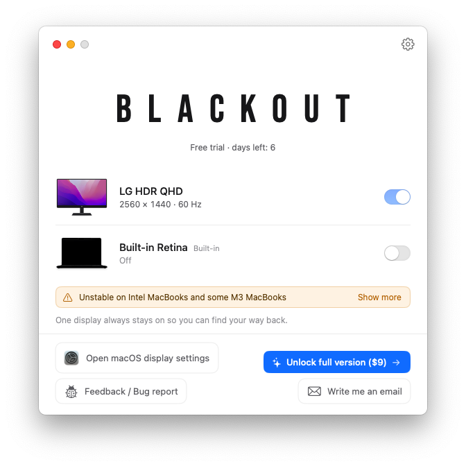
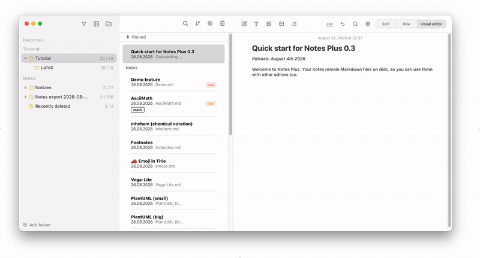

### Hi, I'm Chris 👋

PHP developer turned nomad, now building small, focused desktop apps for people who care about their tools.
Some of my older open-source PHP projects ([huge](https://github.com/panique/huge), [mini](https://github.com/panique/mini), [php-login-minimal](https://github.com/panique/php-login-minimal)) have collected 6,000+ ★ over the years.

---

## 🚀 What I'm building right now

### [🌑 Blackout](https://blackoutapp.io?utm_source=github)
**MacBook screen off. Focus on your external monitor.**

Turns off your MacBook's built-in display while you work on an external monitor, with the lid open, so you can keep using the keyboard, trackpad and Touch ID.

- Per-display on/off switches in one window
- Lives in the menu bar, no Dock icon
- Resets itself automatically on unplug or if anything goes wrong
- 39 languages
- macOS Sequoia+, Apple Silicon & Intel

👉 **[blackoutapp.io](https://blackoutapp.io?utm_source=github)**: free 7-day trial, one-time purchase, no subscription

 

### [📝 Notes Plus](https://notesplus.io?utm_source=github)
**The Apple Notes alternative. Every note is a local Markdown file.**

The Apple Notes experience on top of plain Markdown files on your disk. No lock-in, no proprietary database.

- Raw, split & WYSIWYG editing
- Math (LaTeX/KaTeX), Mermaid, PlantUML, Graphviz, Vega-Lite, Excalidraw
- Kanban view where folders are lanes
- Tags, priorities, favorites, iCloud sync
- macOS & Windows (iOS and Linux on the roadmap)

👉 **[notesplus.io](https://notesplus.io?utm_source=github)**: free during alpha/beta

---

## 🛠️ Classic open-source projects

| Project | ★ | What it is |
|---|---|---|
| [huge](https://github.com/panique/huge) | 2.1k | User authentication embedded in a small PHP framework |
| [mini](https://github.com/panique/mini) | 1.3k | An extremely simple, naked PHP application skeleton |
| [php-login-minimal](https://github.com/panique/php-login-minimal) | 600+ | A minimal login/register script in pure PHP |
| [php-long-polling](https://github.com/panique/php-long-polling) | 400+ | A tiny real-time, self-updating page via long-polling |

---

🌐 [dev-metal.com](https://dev-metal.com) · 🌑 [blackoutapp.io](https://blackoutapp.io?utm_source=github) · 📝 [notesplus.io](https://notesplus.io?utm_source=github)
